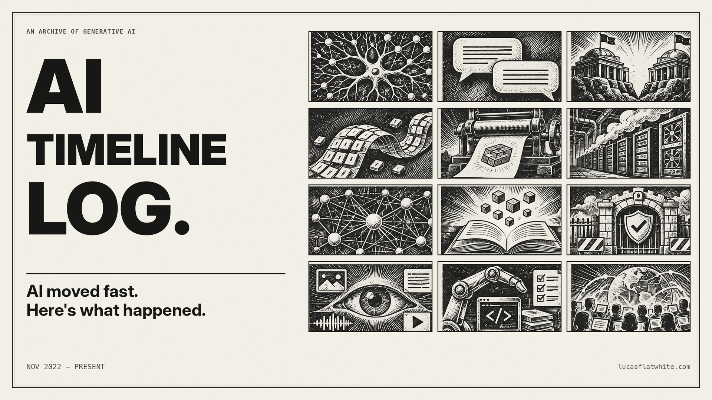

[](https://lucasflatwhite.com/ai-timeline-log/ko/)

# AI Timeline Log

[English](README.md) | 한국어

ChatGPT가 공개된 2022년 11월 30일부터 생성형 AI의 사건들을 기록합니다. 사건을 날짜순으로 정리하고 출처를 남겨, 무슨 일이 있었는지 읽고 원문을 확인할 수 있습니다.

[한국어로 읽기](https://lucasflatwhite.com/ai-timeline-log/ko/) · [Read in English](https://lucasflatwhite.com/ai-timeline-log/)

## 연표

- 흑백 목판화 상자를 최신순으로 늘어놓은 벽입니다. 상자를 열면 사건의 내용과 출처를 읽을 수 있고, 주제별로 여러 장면을 이어 볼 수 있습니다.
- 같은 사실을 바탕으로 영어판과 한국어판을 함께 씁니다. 사실을 고친 경우에는 해당 장면에 정정 기록을 남깁니다.
- [Releases](https://github.com/lucas-flatwhite/ai-timeline-log/releases)에서 판마다 찍은 인쇄용 포스터를 받을 수 있습니다. 다른 곳에서도 읽을 수 있도록 JSON, RSS, 일반 텍스트로 내보냅니다.

생성형 AI의 흐름을 바꾼 사건을 골라 기록합니다. 날짜와 사실은 각 사의 발표문, 논문 등 1차 출처로 확인합니다. 틀린 곳이나 빠진 사건을 발견하면 근거와 함께 [이슈로 알려 주세요](https://github.com/lucas-flatwhite/ai-timeline-log/issues/new/choose).

## 계보 스킬

[`ai-lineage`](skills/ai-lineage)는 이 저장소의 [에이전트 스킬](https://agentskills.io/specification)입니다. AI 기법, 모델 계열, 아이디어가 어디서 나왔는지 물으면, 에이전트가 논문과 발표를 읽고 계보도 하나를 그립니다.

상자는 최대 아홉 개이고, 네 줄(뿌리, 부활, 합류, 확산)로 놓입니다. 상자마다 출처가 붙습니다. 출처를 하나도 열지 못한 상자는 "확인 못 함"으로 표시하고, 선은 확인과 추정으로 나눕니다. PNG, SVG, PDF, Mermaid, 출처 목록이 나옵니다. 완성된 그림은 [`skills/ai-lineage/examples`](skills/ai-lineage/examples)에 있습니다(전문가 혼합, 영어와 한국어). 조사를 시작하기 전에 에이전트가 그림 언어(한국어 또는 영어), 결(먹판, 가까운 변화, 교정지), 범위를 묻습니다.

그림을 그리는 스크립트는 Node.js 20 이상이 필요합니다. 글꼴과 라이브러리는 스킬 안에 들어 있습니다.

## 설치

계보 스킬은 이렇게 설치합니다.

```bash
npx skills add lucas-flatwhite/ai-timeline-log --skill ai-lineage -g
```

컴퓨터에 있는 에이전트(Claude Code, Codex, Cursor, OpenCode, Grok Build 등)를 찾아 설치합니다. 에이전트 하나에만 넣으려면 `-a <id>`를 붙이고, 지금 프로젝트에만 넣으려면 `-g`를 뺍니다. 에이전트 id는 [skills CLI 에이전트 목록](https://github.com/vercel-labs/skills/blob/main/docs/agents.md)에 있습니다.

계보도는 이렇게 맡기면 됩니다. "전문가 혼합은 어디서 나왔는지 그려 줘." 명령을 실행할 수 없는 채팅 앱에서는 그림 없이 데이터 파일, Mermaid, 출처 목록을 받습니다.

이 연표를 날짜와 출처로 답하는 `ai-timeline-log` 스킬은 사이트에서 받습니다.

```bash
npx skills add https://lucasflatwhite.com/ai-timeline-log -g
```

파일을 저장할 수 없는 채팅 앱에서 연표 스킬을 쓰는 법은 [agent.md](https://lucasflatwhite.com/ai-timeline-log/ko/agent.md)에 있습니다.

갱신은 이렇게 합니다.

```bash
npx skills update ai-lineage ai-timeline-log -g
```

## 로컬에서 실행하기

Astro와 TypeScript로 만들었으며, 장면은 YAML로 저장합니다. Node.js 22.22 이상이 필요합니다.

```sh
npm install
npm run dev          # http://localhost:4321/ai-timeline-log/
```

```sh
npm run check
npm test
npm run build
npm run budget
npx playwright install chromium webkit
npm run test:e2e
```

영어판은 `/ai-timeline-log/`, 한국어판은 `/ai-timeline-log/ko/`에 있습니다. 사이트에서 고른 언어는 브라우저에 기억됩니다. PR마다 GitHub Actions가 검사와 브라우저 테스트를 실행합니다. 콘텐츠 편집, 정정, 리서치 방법은 [AGENTS.md](AGENTS.md)에, 포스터와 그림 절차는 `.agents/skills/`에 정리했습니다.

## 라이선스

코드: [MIT](LICENSE). `content/`의 연표 콘텐츠: [CC BY 4.0](content/LICENSE). 계보 스킬에 묶인 라이브러리와 글꼴은 각자의 라이선스를 따릅니다([목록](skills/ai-lineage/THIRD_PARTY_NOTICES.md)).
