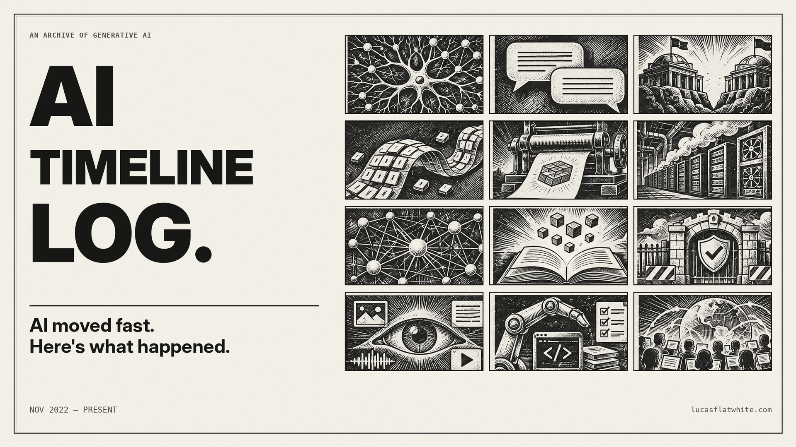

[](https://lucasflatwhite.com/ai-timeline-log/)

# AI Timeline Log

English | [한국어](README.ko.md)

A timeline of generative AI since ChatGPT launched on November 30, 2022. Events appear in date order with links to their sources, so you can read what happened and check the original material.

[Read the timeline](https://lucasflatwhite.com/ai-timeline-log/) · [한국어로 읽기](https://lucasflatwhite.com/ai-timeline-log/ko/)

## The timeline

- A wall of black-and-white woodcut boxes, newest first. Open a box for the story and its sources, or follow a topic across scenes.
- Each scene is written in English and Korean. Factual corrections are recorded in the scene.
- Printable edition posters in [Releases](https://github.com/lucas-flatwhite/ai-timeline-log/releases), plus JSON, RSS and plain-text exports for reading elsewhere.

The timeline focuses on events that shaped generative AI. Dates and claims are checked against company announcements, papers and other primary sources. Found a mistake or a missing event? [Open an issue](https://github.com/lucas-flatwhite/ai-timeline-log/issues/new/choose) with a source.

## Lineage skill

[`ai-lineage`](skills/ai-lineage) is an [agent skill](https://agentskills.io/specification) in this repository. Ask where an AI technique, model family or idea came from. The agent reads the origin papers and releases, then draws one chart.

A chart has at most nine boxes, in four rows: roots, revival, merge, spread. Every box has a source. A box whose sources could not be opened at all is marked "not verified", and every line is marked confirmed or inferred. You get a PNG, an SVG, a PDF, a Mermaid file and a source list. A finished chart, Mixture of Experts in English and Korean, is in [`skills/ai-lineage/examples`](skills/ai-lineage/examples). Before the research starts, the agent asks for the chart language (Korean or English), the look (Woodcut, Soft or Proof) and the scope.

The drawing script needs Node.js 20 or later. Fonts and libraries ship inside the skill.

## Install

Install the lineage skill:

```bash
npx skills add lucas-flatwhite/ai-timeline-log --skill ai-lineage -g
```

This finds the agents on your computer (Claude Code, Codex, Cursor, OpenCode, Grok Build and others) and installs for them. To install for one agent only, add `-a <id>`. For the current project only, drop `-g`. Agent ids are in the [skills CLI agent list](https://github.com/vercel-labs/skills/blob/main/docs/agents.md).

For the lineage chart, ask, for example: "Where did mixture of experts come from?" In a chat app that cannot run commands, you get the data file, a Mermaid version and the source list, with no drawn chart.

The `ai-timeline-log` skill answers questions about this timeline with dates and source links. It installs from the site:

```bash
npx skills add https://lucasflatwhite.com/ai-timeline-log -g
```

To use the timeline skill in a chat app that cannot save a file, see [agent.md](https://lucasflatwhite.com/ai-timeline-log/agent.md) ([한국어](https://lucasflatwhite.com/ai-timeline-log/ko/agent.md)).

To update:

```bash
npx skills update ai-lineage ai-timeline-log -g
```

## Run locally

Built with Astro and TypeScript, with scenes stored as YAML. Requires Node.js 22.22 or later.

```sh
npm install
npm run dev          # http://localhost:4321/ai-timeline-log/
```

```sh
npm run check
npm test
npm run build
npm run budget
npx playwright install chromium webkit
npm run test:e2e
```

English lives at `/ai-timeline-log/`, Korean at `/ai-timeline-log/ko/`. The site remembers your language choice. GitHub Actions runs the checks and browser tests on PRs. See [AGENTS.md](AGENTS.md) for content editing, corrections and research, and `.agents/skills/` for the poster and picture steps.

## License

Code: [MIT](LICENSE). Timeline content in `content/`: [CC BY 4.0](content/LICENSE). The lineage skill bundles third-party libraries and fonts under their own licenses ([list](skills/ai-lineage/THIRD_PARTY_NOTICES.md)).
