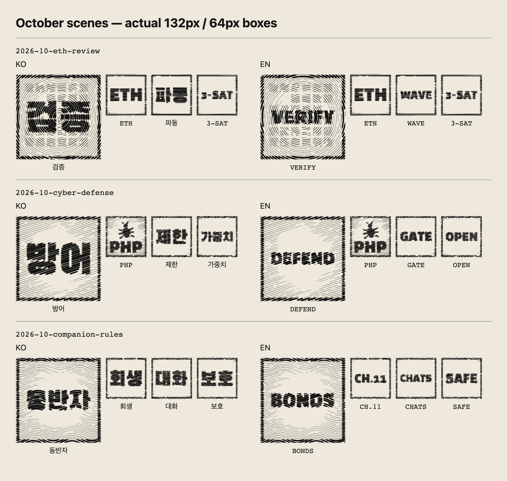
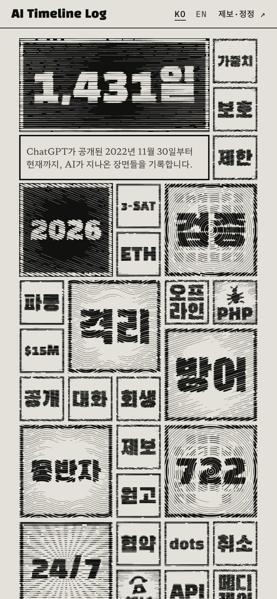
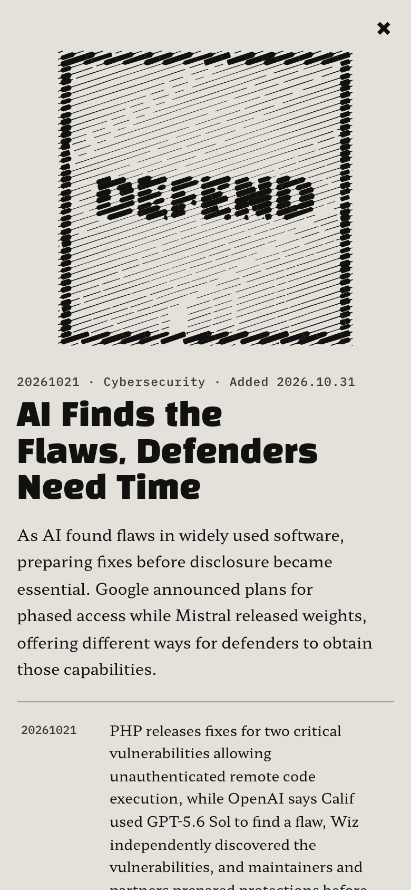

# 2026년 10월 장면과 박스 적용

선정 검토와 디자인 방향을 승인받은 뒤 장면 3개·이벤트 9개를 추가했다. 대표 박스 3개와 사건 박스 9개가 생겨, 전체는 장면 41개·이벤트 157개·연도 박스 포함 203개다. 모델 계보는 연구소 7곳·대표 모델 64개로 보강했다.

## 적용한 장면

| 장면 | 사건 3개 | 대표 박스와 무늬 | 사건 박스의 핵심어 (한국어 / 영어) |
| --- | --- | --- | --- |
| AI의 증명, 학계의 검토 | OpenAI의 ETH 반증 주장, 국소 평활화 추측 관련 공개, Anthropic의 별도 알고리즘 공개 | `검증 / VERIFY`, 동심 무늬와 격자 | `ETH`, `파동 / WAVE`, `3-SAT` |
| AI가 찾은 결함, 방어에 주어진 시간 | PHP 취약점 대응, Gemini 4 Carbon 제한 공개, Mistral Large 4 가중치 공개 | `방어 / DEFEND`, −18도 사선 | `PHP`와 기존 벌레 그림, `제한 / GATE`, `가중치 / OPEN` |
| AI 친구의 파산, 대화의 행방 | Chapter 11 신청, 법무장관들의 소비자 보호 요구, 뉴욕주 법 서명 | `동반자 / BONDS`, 물결 무늬 | `회생 / CH.11`, `대화 / CHATS`, `보호 / SAFE` |

기존 흑백 판화 엔진을 사용했다. 사건 박스는 64×64px, 대표 박스는 칸 사이 간격을 포함해 132×132px다. 새 로고·그림·렌더링 코드는 추가하지 않았다. PHP의 `bug` 그림만 재사용하고 다른 사건은 문자로 표현했다.

첫 화면 검토에서 영어 `WEIGHTS`와 `PROTECT`가 작게 읽혀 `OPEN`과 `SAFE`로 줄였다. `WAVES`·`GATED`도 `WAVE`·`GATE`로 정리했다. 사건의 정확한 모델명과 내용은 상세 글에 유지했다.

별도 검토에서는 Google의 단계적 제공 계획을 이미 완료된 접근 확대처럼 읽을 수 있는 문장 한 곳을 확인해, 두 언어 모두 ‘단계적 제공 예고’로 맞췄다. 모바일에서 접속 조사 ‘과’가 제목의 다음 줄 맨 앞에 놓이지 않도록 동반자 장면 제목에는 쉼표를 썼다.

## 실제 렌더링

브라우저에서 그린 원본 캔버스를 대표 박스 132px·사건 박스 64px 크기로 모았다. 이미지 파일은 고밀도 화면에 맞춰 2배 해상도다.

한국어 모바일 첫 화면(390×844px):

영어 모바일 상세 창:

## 글과 출처

- 모든 새 사건에 개별 출처를 연결했고, 대표 박스에도 장면 출처를 연결했다. 공식 표기는 용어집에 추가했다.
- ETH와 조화해석 결과는 회사의 주장으로 귀속했다. 검토 진행 상태와 형식 증명 검사·명제 해석의 차이를 장면 설명에 남겼다. Anthropic 사건 날짜는 추가 커밋의 UTC 날짜다.
- Chapter 11은 신청·매각 절차로 설명하고 회사의 운영 지속 입장을 적었다. 민감한 대화 데이터가 실제 이전됐다고 단정하지 않았다.
- 뉴욕주 법의 서명일은 2026-10-28, 시행일은 2027-01-01로 구분했다.
- 2026년 요약은 기존의 속도 조절·격리라는 흐름을 유지하면서 수학 검증과 동반자 챗봇 보호 문제를 보충했다.
- ARTEX, 투자 회의론, 미 하원의 사고 보고 요구는 선정 검토 문서에 후속 후보로 남겼다.

## 검증

- `npm run check`: 오류 0·경고 0, 기존 hint 29개.
- `npm test`: 89개 통과. 장면·사건 수와 최신 추가 표시의 기존 기대값을 갱신했다.
- `npm run build`: 한국어·영어 정적 페이지 생성 성공, 콘텐츠 경고 없음.
- `npm run budget`: 영어 판 글꼴 7,036B, 한국어 판 글꼴 22,256B, 클라이언트 JS 15,254B로 모두 예산 이내.
- `npx playwright test --project=chromium`: 78개 통과.
- 별도 화면 검증: 한국어·영어 각각 1440×960px 및 390×844px에서 새 박스 12개의 핵심어·그림 생성, 장면 3개와 사건 9개의 열기·출처 전환, 가로 넘침과 브라우저 오류 유무를 확인했다.
- 공유 이미지 `public/og/ko.png`, `public/og/en.png`를 새 화면에서 다시 생성했다.

조사 범위와 근거 링크는 [사건 선정·계보 검토](2026-10-31-events-and-lineage.md)에 있다.
