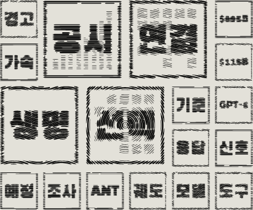
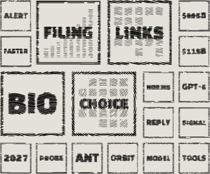
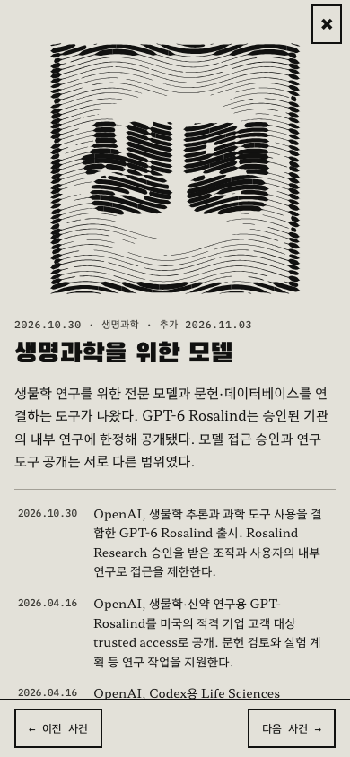
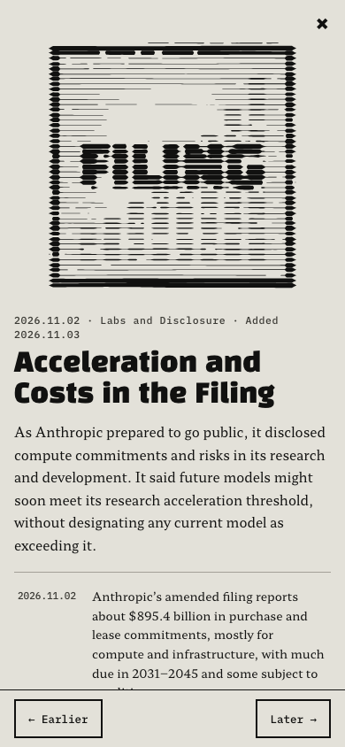

# 11월 초 사건과 박스 반영

확인일: 2026-11-03. 사용자가 선정한 우선 후보 6묶음과 GPT-6 Rosalind를 반영했다. 상세 출처와 제외 사유는 [리서치 기록](2026-11-03-event-research.md)에 있다.

## 변경

| 구분 | 장면 | 사건 구성 |
| --- | --- | --- |
| 추가 | 학습에 쓰지 말라는 신호 | 10월 30일 OpenAI와 Google의 공통 신호 지원 계획, CMA의 Meta 약관 개정안 조사 |
| 추가 | 공시에 적힌 가속과 비용 | 10월 26일 공개 S-1 제출, 11월 2일 계산 약정과 미래 모델의 연구 가속 기준에 관한 공시 |
| 추가 | AI 계산망의 새 연결 | 10월 1일 Suncatcher 발사, 10월 30일 우주 TPU 응답 발표, 11월 2일 Marvell·Lumentum 인수 계약 발표 |
| 추가 | 생명과학을 위한 모델 | 4월 16일 GPT-Rosalind와 연구 plugin 공개, 10월 30일 GPT-6 Rosalind 제한 출시 |
| 보완 | 검토를 기다리는 반증 | 10월 30일 Harvard CMSA 정상회의 주최자들의 권고문 공개 |
| 보완 | AI가 찾은 결함 | 11월 3일 NCSC의 AI 악성코드 위험 전망 |

새 장면은 각 사건 3개이고, 기존 장면 2개는 3개에서 4개로 늘었다. 모델 계열과 프로젝트를 이해하는 데 필요한 최초 공개·발사·공개 공시를 배경으로 보충했다. 미선정 후보인 HUMAIN, Grid Protectors, LongCat, DeepSeek prototype, CrowdStrike는 추가하지 않았다.

콘텐츠 로더로 65장면·244사건·연도 상자 5개, 총 314상자를 확인했다. 기존 61장면·230사건의 주소와 사건 객체를 원래 작업 폴더의 콘텐츠와 비교해 모두 보존됐음을 확인했다. 새 장면 4개와 사건 14개로 상자는 18개 늘었다.

`asOf`는 2026-11-03으로 갱신했다. 2026년 요약과 용어집도 보완했다. Rosalind는 생명과학 전문 모델이므로 대표 범용 모델 계보의 범위를 바꾸지 않았다. 포스터 새 판은 발행하지 않았으며 기존 제5판 다운로드 링크를 유지했다.

## 사실 검토

- 공통 학습 신호는 도입 계획, CMA는 조사 개시이며 Meta의 개정안 시행이 보류됐다고 명시했다. 별도 검토에서 시행된 약관처럼 읽힐 수 있다는 지적을 받고 CMA 원문을 재확인해 두 언어를 수정했다.
- Suncatcher의 10월 30일은 응답 시험의 발표일이다. 실제 시험일로 단정하거나 상용 우주 데이터센터 개통으로 설명하지 않았다.
- Marvell 거래는 기업가치 1,150억 달러의 주식 교환 계약이다. 현금 지급이나 완료된 인수로 쓰지 않았다.
- Anthropic의 8,954억 달러는 장기 구매·임차 약정이며 일부는 조건부다. 미래 모델의 연구 가속 전망과 현행 모델의 기준 지정 여부를 구분했다.
- 수학 권고문은 회의일 10월 22~23일과 공개일 30일을 구분했다. ETH가 검증됐다고 쓰지 않았다.
- NCSC 항목은 2028년까지의 위험 전망이다. 공격이 실제 발생했다고 쓰지 않았다.
- GPT-Rosalind의 4월 최초 공개와 GPT-6 Rosalind의 10월 제한 출시를 구분했다. 연구 도구 공개가 모델 접근 승인을 뜻하지 않는다고 설명했다.

## 화면 확인

추가된 상자만 모은 아래 이미지는 검토용이다. 실제 벽에서는 기존 상자와 함께 날짜순으로 배치된다. 기존 판화 문법을 사용하며 UI 코드나 그림 목록을 바꾸지 않았다.

390×844 모바일 화면에서 한국어·영어 첫 화면과 Rosalind·Anthropic 상세 창을 확인했다. 두 상세 창의 가로 넘침을 검사했고, 글과 닫기·이전·다음 버튼이 표시되는 것을 확인했다.

## 검증

- 기준 상태에서 단위 테스트 154개 통과.
- `npm run check`: 오류 0, 경고 0. 기존 파일의 hint 30개는 남아 있다.
- `npm test`: 154개 통과. 기존 콘텐츠 수, 최신 날짜, 새 장면 표시와 주제별 개수의 기대값을 갱신했다.
- `npm run build`: 한국어·영어 정적 페이지와 내보내기 파일 생성 완료.
- `npm run budget`: 영어 판 글꼴 7,152B, 한국어 판 글꼴 26,448B, 클라이언트 JS 27,195B로 모두 한도 이내.
- Chromium·WebKit 전체 E2E 286개 통과. 기존 4321 포트의 서버를 건드리지 않도록 별도 4337 포트와 로컬 시험 설정을 사용했다.
- 한국어·영어 OG 이미지를 별도 미리보기 서버에서 다시 생성했다.
- `git diff --check` 통과. 내부 설계·계획과 생성된 판 글꼴은 추적하지 않는다.
